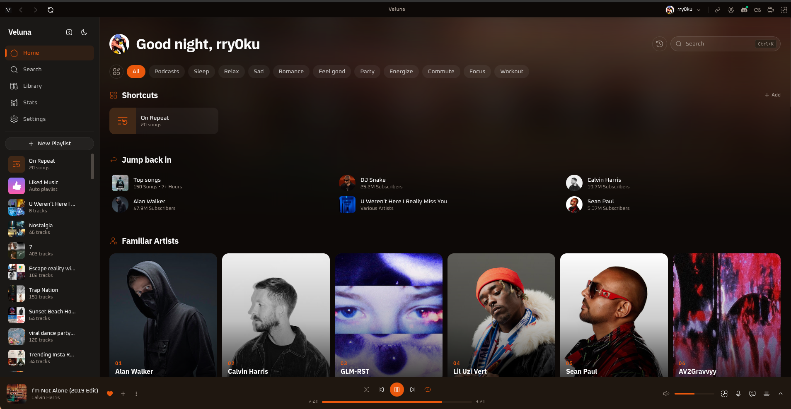
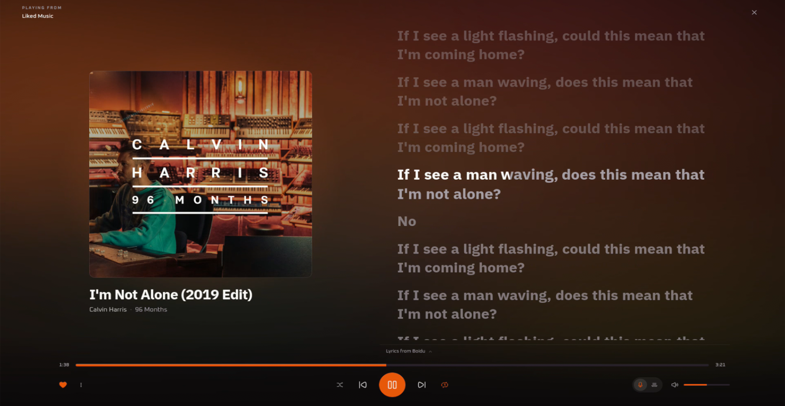

# Veluna

<p align="center">
  
</p>

<h2 align="center">The desktop music player built for people who want to own their listening experience.</h2>

<p align="center">
Stream anything from YouTube. Download high-quality offline tracks. Manage your local library.<br/>
No subscriptions. No advertisements. Zero telemetry. 100% private.<br/>
Native desktop performance built with Rust and Tauri for Windows, macOS, and Linux.
</p>

<p align="center">
  <a href="https://github.com/rry0ku/veluna/releases"></a>
  <a href="https://discord.com/invite/u7QXUgPcqr"></a>
</p>

<p align="center">
  
</p>

<p align="center">
  
</p>

<p align="center">
  <a href="https://github.com/rry0ku/veluna/releases"></a>
  <a href="LICENSE"></a>
  <a href="https://tauri.app"></a>
  <a href="https://www.rust-lang.org"></a>
  <a href="https://svelte.dev"></a>
  <a href="https://github.com/rry0ku/veluna/stargazers"></a>
</p>

<p align="center">
  <strong><a href="https://github.com/rry0ku/veluna/releases">Download Releases</a></strong> |
  <strong><a href="#building-from-source">Build from Source</a></strong> |
  <strong><a href="CONTRIBUTING.md">Contribute</a></strong> |
  <strong><a href="https://github.com/rry0ku/veluna/issues">Report an Issue</a></strong> |
  <strong><a href="#legal-and-fair-use">Legal and Fair Use</a></strong>
</p>

---

## Why Veluna?

Veluna is a fast, lightweight desktop music player built with Rust, Tauri, and Svelte 5. It connects you directly to millions of tracks with zero ads, high-speed offline downloads, synchronized lyrics, and complete local library management. Everything is stored locally on your machine with zero telemetry, giving you full ownership over your listening experience.

---

## Core Features

### Instant Streaming and Discovery
- Low-latency YouTube Music playback powered by a native mpv audio pipeline.
- Dual-mode search: discover official audio tracks and music videos side by side.
- Quick Picks shelf on the Home view for instant access to your favorite and frequent songs.
- Dynamic genre shelves (Hip-Hop, EDM, Pop, Rock, R&B, Lo-Fi, K-Pop, and more).
- Smart autoplay recommendations that automatically queue similar tracks when playback finishes.

### Synchronized Lyrics and Theater Mode
- Real-time scrolling lyrics synchronized to audio playback with click-to-seek navigation.
- Immersive full-screen theater mode with dynamic blurred album art backdrop.
- Romanization and multi-provider fallback support (lrclib, Musixmatch, NetEase).

### High-Speed Audio Downloader
- Single-click offline downloads from search results, playlists, albums, or context menus.
- Supported output formats: MP3, Opus, and M4A.
- Quality presets: High (320kbps+), Medium (~128kbps), and Low.
- Automatic ID3 metadata tagging and embedded album cover art via ffmpeg and lofty.
- Active Downloads drawer with live speed and progress tracking.

### Offline Library and Metadata Editor
- Automatic directory scanner that reads local audio files, tags, and embedded artwork.
- Built-in metadata editor to update Title, Artist, Album, and Track tags directly on local files.
- Waveform preview scrubbers for local audio tracks.
- Multi-select batch actions (Shift+Click / Ctrl+Click) to queue, play, or remove.
- In-memory instant search across your entire offline catalog.
- Standard M3U playlist import and export.

### Artists Hub and Discographies
- Dedicated Artists view with search and direct discography navigation.
- High-definition profile artwork and artist banners.
- Local follow system to keep track of your favorite artists.
- Full release catalogs covering top songs, singles, and full studio albums.

### Playlist Management and Migration
- Custom playlist creation with custom image uploads and drag-and-drop reordering.
- Import Spotify playlists: upload CSV files from exportify.net for automated YouTube matching.
- Import YouTube playlists: paste any public YouTube or YouTube Music playlist URL.
- Duplicate track detection with one-click cleanup.

### High-Fidelity Audio Control
- Gapless playback transitions and background stream prefetching.
- Customizable crossfade duration (0 to 12 seconds).
- 10-band graphic equalizer with real-time frequency curve adjustments and presets.
- EBU R128 loudness normalization and silence skipping.
- Variable playback speed control (0.5x to 2.0x).
- Background LRU disk cache with custom size limits (500MB to Unlimited).

### Listening Stats and Playback History
- Comprehensive listening history with timestamps and repeat counters.
- Interactive listening analytics powered by LayerChart: daily listening trends, top artists, and top tracks.

### Desktop Integration and Customization
- Native Linux MPRIS2 D-Bus interface (org.mpris.MediaPlayer2.veluna) for playerctl, GNOME, KDE, and lockscreen controls.
- Discord Rich Presence: displays active track, artist, elapsed time, and artwork.
- Last.fm and ListenBrainz scrobbling support with real-time Now Playing status.
- System tray minimization with quick playback menu.
- Global hardware media key bindings.
- Custom theming engine: warm orange accent palette, dynamic album-art background tinting, and dark/light modes.
- Full JSON configuration backup and restore.

---

## Installation

### Linux

**Arch Linux / Manjaro / EndeavourOS**:
```bash
sudo pacman -U ./veluna_<version>-1-x86_64.pkg.tar.zst
```

**Debian / Ubuntu / Linux Mint (.deb)**:
```bash
sudo apt install ./veluna_<version>_amd64.deb
```

**Fedora / RHEL / openSUSE (.rpm)**:
```bash
sudo dnf install ./veluna_<version>.x86_64.rpm
# or for openSUSE:
sudo zypper install ./veluna_<version>.x86_64.rpm
```

### Windows

Download and run the `.exe` setup installer from the [Releases](https://github.com/rry0ku/veluna/releases) page. Runtime dependencies are bundled automatically.

---

## Building from Source

### Prerequisites

- Node.js 18 or higher
- Rust (stable toolchain)
- Tauri CLI v2 (`cargo install tauri-cli --version "^2"`)
- Linux build dependencies: `mpv`, `ffmpeg`, `libasound2-dev`, `libwebkit2gtk-4.1-dev`

### Compilation

```bash
git clone https://github.com/rry0ku/veluna.git
cd veluna
npm install
npm run build
npm run tauri build
```

To run in development mode:
```bash
npm run dev
```

---

## Tech Stack

| Component | Technology | Role |
|---|---|---|
| Shell | Tauri v2 | Native windowing, IPC bridge, system integration |
| Frontend | Svelte 5 + SvelteKit + TypeScript | Reactive UI state, LayerChart visualizations, Tailwind CSS v4 |
| Audio Backend | mpv via Rust IPC | Low-latency audio pipeline, software EQ, gapless playback |
| Media Resolver | yt-dlp | YouTube Music search, streaming stream extraction, downloading |
| Audio Utilities | ffmpeg / ffprobe | ID3 metadata tagging, format transcoding, waveform generation |
| Linux Integration | zbus | MPRIS2 D-Bus service (org.mpris.MediaPlayer2.veluna) |
| Rich Presence | discord-rich-presence | Active playback status and artwork sync |

---

## Privacy and Data

All application state, playlists, and listening statistics are stored locally on your machine in SQLite and localStorage. Veluna does not collect telemetry, crash logs, or user analytics. Network requests are made strictly to resolve audio streams, retrieve lyrics, embed album artwork, or check for new releases.

---

## Legal and Fair Use

Veluna is a client-side media player. It does not host, cache, or redistribute copyrighted media on external servers. All streaming and download features operate directly on the user's machine through publicly accessible endpoints for personal, non-commercial use.

---

## License

GNU General Public License v3.0. Copyright (c) 2026 [rry0ku](https://github.com/rry0ku).
